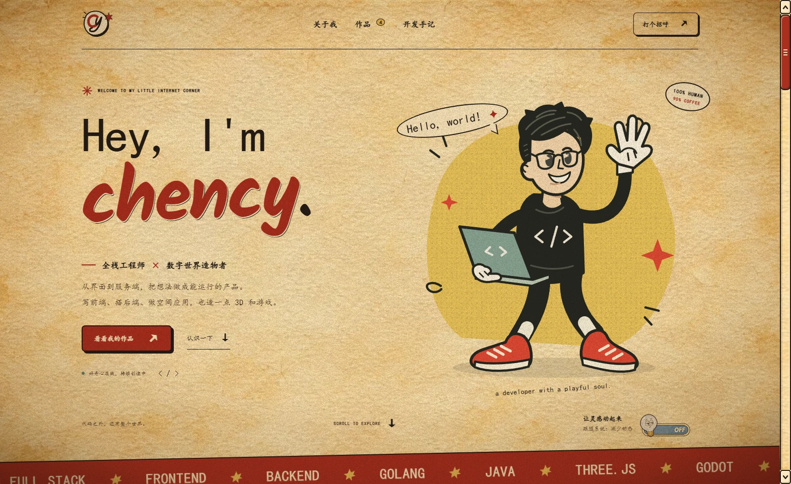
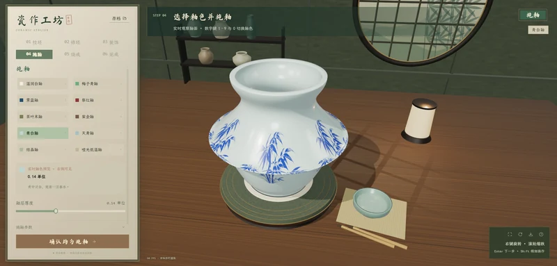

<div align="center">


**一个有温度、有动效，也能离线带走的个人数字游乐场。**

泛黄的纸张、朱红的手写签名、会挥手的程序员。<br>
把界面、空间、3D 和游戏里的小想法，做成真正能点开玩的东西。

[页面预览](#页面预览) · [精选作品](#精选作品) · [互动实验](#互动实验) · [开始使用](#开始使用) · [按你的方式修改](#按你的方式修改)


[**下载离线页面 ↗**](https://github.com/chency9/personal-website/raw/refs/heads/main/offline.html) &nbsp; / &nbsp; [浏览源码](src) &nbsp; / &nbsp; [验证记录](docs/validation.md)

</div>

<br>

## 页面预览

<a href="docs/assets/home-desktop.webp"></a>

<p align="center"><sub>真实页面截图 · 原创 SVG 人物 · 本地字体 · 自适应布局</sub></p>

### 让这个小站有自己性格的细节

| 纸上的视觉 | 浏览器里的互动 |
| :--- | :--- |
| **旧纸与胶片**：纸张纹理、颗粒、细小划痕和轻微画面抖动。 | **卡通控件**：灯泡开关、标签、滑杆与吐司，保留弹性动画和操作反馈。 |
| **个人签名**：原创 CY 徽记、克制的手写名字与纹理短发、眼镜男生插画。 | **入场问候**：`Hello, world!` 逐字出现，光标在结束后收起。 |
| **统一的滚动条**：纸质轨道、墨线轮廓、朱红滑块和箭头按钮。 | **照顾不同偏好**：可暂停页面动画，尊重系统减少动态设置，支持键盘与触屏。 |

## 精选作品

四个独立作品，一页收纳。点击封面或作品名，可以访问对应网站。

<table>
  <tr>
    <td width="50%" valign="top">
      <a href="https://docs.chency.site/ceramic/offline.html"></a>
      <h3><a href="https://docs.chency.site/ceramic/offline.html">瓷作工坊 ↗</a></h3>
      <p>在浏览器里体验制瓷与施釉，把一件器物慢慢做出来。</p>
      <p><code>手作体验</code> <code>交互设计</code></p>
    </td>
    <td width="50%" valign="top">
      <a href="https://docs.chency.site/mechanical3d/"></a>
      <h3><a href="https://docs.chency.site/mechanical3d/">3D 机械拆解 ↗</a></h3>
      <p>拆开仿生机械，观察部件结构，以及它们如何一起运动。</p>
      <p><code>3D 可视化</code> <code>机械探索</code></p>
    </td>
  </tr>
  <tr>
    <td width="50%" valign="top">
      <a href="https://docs.chency.site/shanmenzhi/"></a>
      <h3><a href="https://docs.chency.site/shanmenzhi/">山门志 ↗</a></h3>
      <p>从一座山门开始的武侠门派经营游戏。需管理员分配账号。</p>
      <p><code>武侠世界</code> <code>经营游戏</code></p>
    </td>
    <td width="50%" valign="top">
      <a href="https://docs.chency.site/md2book.html"></a>
      <h3><a href="https://docs.chency.site/md2book.html">Markdown 排版引擎 ↗</a></h3>
      <p>从 Markdown 到有风格的文档，支持书籍信息配置与双端预览。</p>
      <p><code>文档排版</code> <code>创作工具</code></p>
    </td>
  </tr>
</table>

## 互动实验

主页里还有三个真正可运行的小实验。打开卡片就能玩，关闭时会释放图形与事件资源。

| 实验 | 可以怎么玩 | 实现 |
| :--- | :--- | :--- |
| **城市漫游** | 拖动与缩放西湖示意地图，筛选地点、拾取坐标，也可用键盘选择地点。 | OpenLayers · 本地矢量数据 |
| **造一颗小星球** | 拖动观察、缩放，切换三套程序化配色、实体 / 线框、自转与视角。 | Three.js · WebGL · OrbitControls |
| **像素出逃计划** | 用方向键或 A / D 移动，W / 空格跳跃，收集五枚芯片；支持触屏。 | Canvas · 平台碰撞 · 游戏循环 |

> 地图使用简化演示数据，适合探索交互；星球需要浏览器支持 WebGL。像素游戏是受 Godot 开发思路启发的 Canvas 原型。

此外还可以调一份「灵感配方」、读三篇实验开发手记，或按下打招呼按钮，收获一片好运吐司。

## 开始使用

### 只想打开看看

**下载 [`offline.html`](https://github.com/chency9/personal-website/raw/refs/heads/main/offline.html)，保存到本地后双击即可。**

无需安装 Node.js，无需启动服务器。字体、图片、脚本、卡通控件与三个实验的代码都在这一个文件里，可以单独复制、改名或分享。

| 文件 | 用途 |
| :--- | :--- |
| `offline.html` | 仓库自带的完整离线页面，下载后直接打开。 |
| `index.html` | 开发入口；双击时自动跳转到同目录的 `offline.html`。 |
| `dist/index.html` | 构建后生成的同款单文件页面，也适合静态部署。 |

精选作品的外部网站和 GitHub 链接需要网络；站内实验使用本地资源。

### 想改一改源码

需要 **Node.js 20.19+ 或 22.12+**，以及 npm。

```bash
git clone https://github.com/chency9/personal-website.git
cd personal-website
npm ci
npm run dev
```

浏览器打开终端显示的本地地址。常用命令：

| 命令 | 作用 |
| :--- | :--- |
| `npm run dev` | 启动本地开发服务，修改后即时更新。 |
| `npm run build` | 检查 TypeScript、构建网站，并更新两份单文件 HTML。 |
| `npm run preview` | 预览构建结果。 |

**修改源码后，运行一次 `npm run build`，离线页面才会同步更新。**

### 放到自己的服务器

运行 `npm run build` 后，将 `dist/` 目录上传到静态托管平台即可，也支持放在子目录。可以使用 GitHub Pages、Cloudflare Pages、Netlify，或自己的静态服务器。

使用带构建设置的托管平台时，构建命令填 `npm run build`，发布目录填 `dist`。本仓库没有预设自动部署流程。

## 按你的方式修改

```text
personal-website/
├── src/
│   ├── main.ts                页面内容、事件与实验入口
│   ├── style.css              视觉主题、响应式布局与滚动条
│   ├── art.ts                 原创人物与实验 SVG 插画
│   ├── greeting.ts            入场打字动画
│   ├── profile.ts             个人信息与联系方式
│   ├── portfolio.ts           精选作品资料
│   ├── playground.ts          灵感配方互动
│   ├── hose-controls.ts       卡通控件与页面动画设置
│   ├── assets/chency-logo.svg  CY 动态徽记
│   └── labs/                  地图、星球与像素游戏
├── public/                    本地字体、作品封面、纹理与第三方控件
├── scripts/build-offline.mjs   单文件离线打包
├── docs/                      文档、预览与验证记录
├── index.html                 开发入口
└── offline.html               可双击的完整页面
```

| 想修改什么 | 从这里开始 |
| :--- | :--- |
| 邮箱与 GitHub 联系入口 | [`src/profile.ts`](src/profile.ts)。 |
| 首屏名字与个人介绍 | [`src/main.ts`](src/main.ts)；中文、英文文案在页面模板中。 |
| 作品标题、封面与访问链接 | [`src/portfolio.ts`](src/portfolio.ts) 和 [`public/projects/`](public/projects)。 |
| 人物、发型、眼镜和插画 | [`src/art.ts`](src/art.ts)。 |
| Logo 与名字字体 | [`src/assets/chency-logo.svg`](src/assets/chency-logo.svg) 和 [`public/fonts/chency-script/`](public/fonts/chency-script)。 |
| 颜色、布局、动画与滚动条 | [`src/style.css`](src/style.css)；问候动画逻辑在 [`src/greeting.ts`](src/greeting.ts)。 |

<details>
<summary><strong>关于离线打包、性能与页面行为</strong></summary>

<br>

- 开发模式将地图和星球模块拆分，打开对应实验时再加载；离线版会将它们全部内嵌，让单个 HTML 可以独立运行。
- 单文件页面约 **8.33 MiB**。打包脚本会内联本地字体、图片、样式与脚本，并检查是否还残留外部脚本或样式引用。
- Three.js 实验的构建分包约 500 KB，Vite 会给出体积提示；它仍会正常构建。
- 当前网站是静态前端。Go、Java 与 Godot 是个人技术方向，当前仓库使用 TypeScript、Vite、OpenLayers、Three.js 与 Canvas。
- 邮箱与 GitHub 联系入口从 `profile.ts` 读取；留空时显示整理中的提示。打招呼按钮只在页面内回应。
- 页面不请求定位、不收集访客个人数据，站点运行不依赖远程字体或地图瓦片。
- 动画支持暂停及系统减少动态偏好；弹窗使用原生 `dialog`，提供键盘焦点与触屏操作。

具体的构建、离线与交互检查见 [`docs/validation.md`](docs/validation.md)。

</details>

## 设计来源与致谢

视觉灵感来自 1930 年代 Rubber Hose 卡通语言：粗墨线、弹性肢体、白手套、大鞋，以及有一点顽皮的交互。

| 素材 / 组件 | 来源与许可说明 |
| :--- | :--- |
| Rubber Hose UI | [上游项目](https://github.com/finktheartist/rubber-hose-ui) · 本地组件保留 [MIT 许可](public/vendor/rubber-hose/LICENSE)；[设计参考记录](docs/rubber-hose-ui-upstream.md)。 |
| 本地字体 | Lilita One、DM Sans、霞鹜文楷与 Kalam / Chency Hand；字体目录保留各自的 SIL Open Font License。 |
| CY 徽记与人物 | 项目原创 SVG；README 封面复用站内徽记、人物与本地字体字形。 |
| 作品封面 | 来自作者提供的真实作品截图；见 [封面来源](public/projects/SOURCE.md)。 |
| 纸张与胶片效果 | 来自作者指定的参考页面；见 [纹理来源](public/textures/SOURCE.md)。 |

本仓库未另行声明项目整体的开源许可证；第三方素材与组件遵循各自许可。

<br>

<div align="center">


**保持好奇，保持动手。**

<sub>Made by <a href="https://github.com/chency9">chency</a> · 用代码和好奇心搭建</sub>

[回到顶部 ↑](#)

</div>
