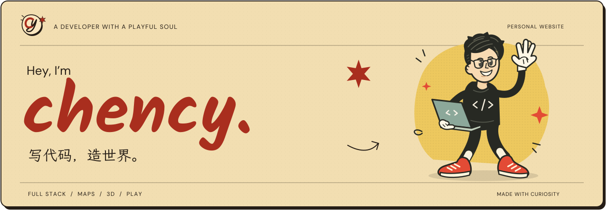
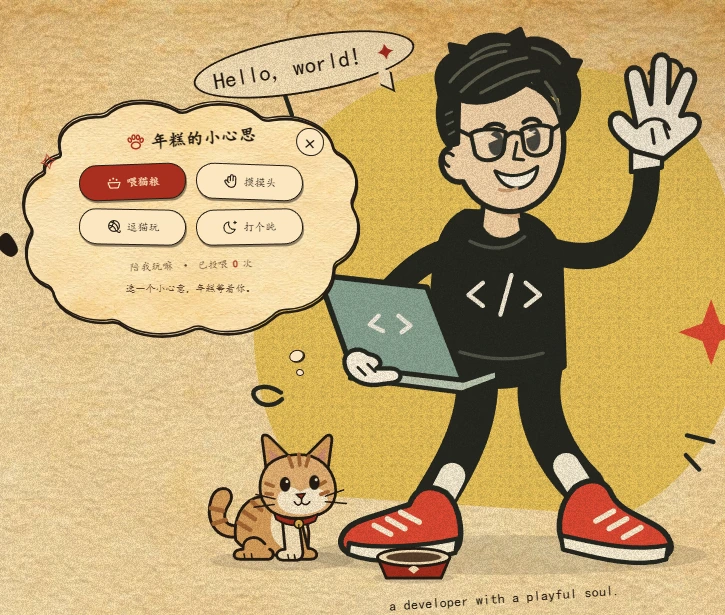
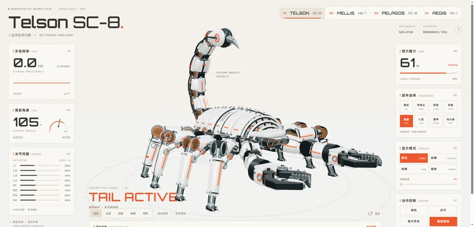
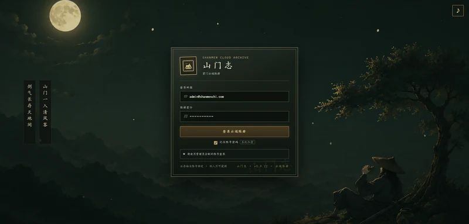
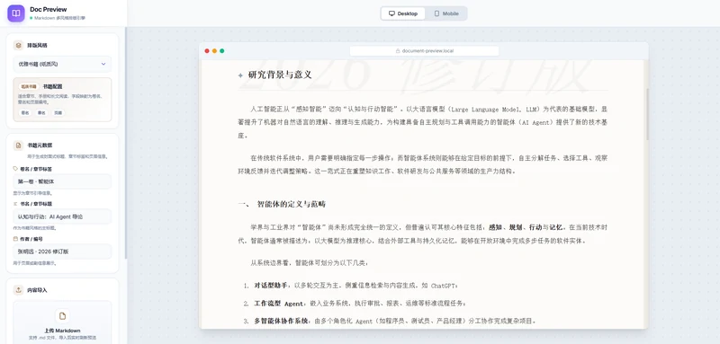
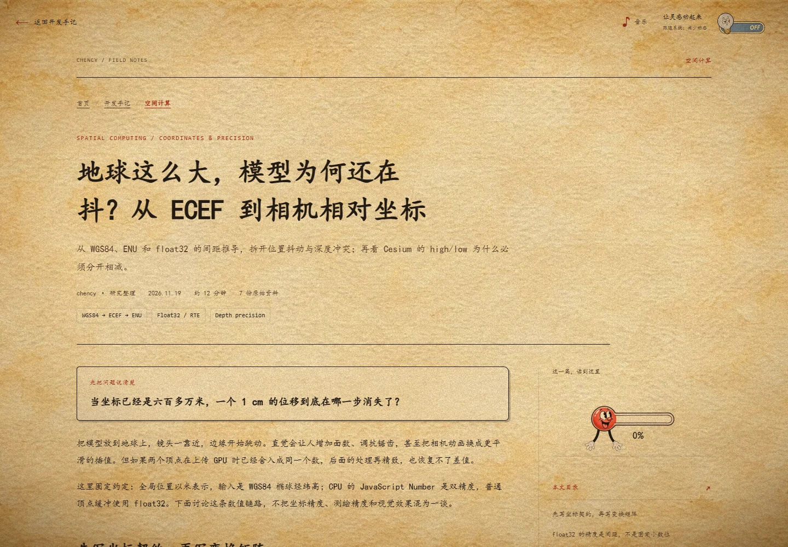
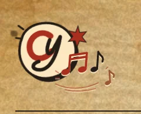

<div align="center">



**一个有温度、有动效，也能离线带走的个人数字游乐场。**

泛黄的纸张、朱红的手写签名、会挥手的程序员。<br>
把界面、空间、3D 和游戏里的小想法，做成真正能点开玩的东西。

[页面预览](#页面预览) · [精选作品](#精选作品) · [互动实验](#互动实验) · [开始使用](#开始使用) · [按你的方式修改](#按你的方式修改)


[**下载离线页面 ↗**](https://github.com/chency9/personal-website/raw/refs/heads/main/offline.html) &nbsp; / &nbsp; [浏览源码](src) &nbsp; / &nbsp; [验证记录](docs/validation.md)

</div>

<br>

## 页面预览

<a href="docs/assets/home-desktop.webp"></a>

<p align="center"><sub>真实页面截图 · 原创 SVG 人物 · 本地字体 · 自适应布局</sub></p>

### 让这个小站有自己性格的细节

| 纸上的视觉 | 浏览器里的互动 |
| :--- | :--- |
| **旧纸与胶片**：纸张纹理、颗粒、细小划痕和轻微画面抖动。 | **卡通控件**：灯泡开关、标签、滑杆与吐司，保留弹性动画和操作反馈。 |
| **个人签名**：原创 CY 徽记、克制的手写名字与纹理短发、眼镜男生插画。 | **入场问候**：`Hello, world!` 逐字出现，光标在结束后收起。 |
| **统一的滚动条**：纸质轨道、墨线轮廓、朱红滑块和箭头按钮。 | **照顾不同偏好**：可暂停页面动画，尊重系统减少动态设置，支持键盘与触屏。 |

### 人物脚边，还住着一只小猫

**年糕**是这个小站的摸鱼搭子：一只戴朱红项圈的奶油橘猫，由 SVG 绘制。点击小猫，人物左上方会弹出边缘自由起伏的手绘思考气泡，带着猫爪、小星星和两颗圆泡；手机上会优先放在插画上方。四颗饱满的软圆按钮微微错落，选择动作后气泡收起，留出画面看它玩耍。点击空白处、再次点击小猫或按 Escape 也能关闭。

<p align="center"></p>

- **喂猫粮**：倒粮、走近、低头吃、舔嘴，吃完会记录本次访问的投喂次数。
- **摸摸头**：点气泡里的「摸摸头」，它会眯眼、蹭头、摆尾，冒出小爱心。
- **逗猫玩**：抛出毛线球，小猫会盯住、追逐、扑跳，再跑回你身边。
- **打个盹**：趴下休息，点「叫醒它」或其他互动就能继续玩。

平时还会眨眼、动耳朵、舔嘴、伸懒腰。关闭页面动画与抖动后，自动待机动作停止，点击触发的喂食、摸头、追球和入睡仍会完整播放，结束后恢复静止。互动支持触屏和键盘；系统开启减少动态时保留静态表情和操作结果。离开画面或切到其他标签页时暂停动作。全程在本地运行，不保存跨次访问的喂食记录。

## 精选作品

四个独立作品，一页收纳。点击封面或作品名，可以访问对应网站。

<table>
  <tr>
    <td width="50%" valign="top">
      <a href="https://docs.chency.site/ceramic/offline.html"></a>
      <h3><a href="https://docs.chency.site/ceramic/offline.html">瓷作工坊 ↗</a></h3>
      <p>在浏览器里体验制瓷与施釉，把一件器物慢慢做出来。</p>
      <p><code>手作体验</code> <code>交互设计</code></p>
    </td>
    <td width="50%" valign="top">
      <a href="https://docs.chency.site/mechanical3d/"></a>
      <h3><a href="https://docs.chency.site/mechanical3d/">3D 机械拆解 ↗</a></h3>
      <p>拆开仿生机械，观察部件结构，以及它们如何一起运动。</p>
      <p><code>3D 可视化</code> <code>机械探索</code></p>
    </td>
  </tr>
  <tr>
    <td width="50%" valign="top">
      <a href="https://docs.chency.site/shanmenzhi/"></a>
      <h3><a href="https://docs.chency.site/shanmenzhi/">山门志 ↗</a></h3>
      <p>从一座山门开始的武侠门派经营游戏。需管理员分配账号。</p>
      <p><code>武侠世界</code> <code>经营游戏</code></p>
    </td>
    <td width="50%" valign="top">
      <a href="https://docs.chency.site/md2book.html"></a>
      <h3><a href="https://docs.chency.site/md2book.html">Markdown 排版引擎 ↗</a></h3>
      <p>从 Markdown 到有风格的文档，支持书籍信息配置与双端预览。</p>
      <p><code>文档排版</code> <code>创作工具</code></p>
    </td>
  </tr>
</table>

## 互动实验

主页里还有三个真正可运行的小实验。打开卡片就能玩，关闭时会释放图形与事件资源。

| 实验 | 可以怎么玩 | 实现 |
| :--- | :--- | :--- |
| **城市漫游** | 拖动与缩放西湖示意地图，筛选地点、拾取坐标，也可用键盘选择地点。 | OpenLayers · 本地矢量数据 |
| **造一颗小星球** | 拖动观察、缩放，切换三套程序化配色、实体 / 线框、自转与视角。 | Three.js · WebGL · OrbitControls |
| **像素出逃计划** | 用方向键或 A / D 移动，W / 空格跳跃，收集五枚芯片；支持触屏。 | Canvas · 平台碰撞 · 游戏循环 |

> 地图使用简化演示数据，适合探索交互；星球需要浏览器支持 WebGL。像素游戏是受 Godot 开发思路启发的 Canvas 原型。

卡通控件散落在真正用得上的地方，陪你完成一次操作：

| 小家伙 | 现在负责什么 |
| :--- | :--- |
| **钢笔** | 在地图实验中搜索地点。 |
| **圆脸单选** | 给小星球选择一套配色。 |
| **温度计** | 显示当前文章的真实阅读进度。 |
| **长号** | 调节背景音乐音量，支持静音与本地记忆。 |
| **青绿方框** | 切换星球的线框视图。 |
| **五颗星星** | 在文章末尾留下评分，每篇独立，仅保存在当前浏览器。 |

灯泡仍负责页面动画，红按钮与吐司机留在联系区。每个角色都对应实际功能。

## 从原理，走到工程边界

开发手记整理为四篇技术长文。点击首页文章进入独立阅读页，保留纸张、墨线与朱红配色，提供目录、正文引用和参考原文；地址可收藏、刷新直达，也可用浏览器返回。

文章页用一条简洁顶栏放置返回、音乐和动效开关：返回在左，关闭动画与抖动的灯泡在右上角，可随时操作。温度计与目录放在一起，跟随正文与参考资料的真实滚动进度；正文保持居中，手机上目录与进度自然排列在正文前。CY Logo 只在首页出现，阅读页以文字按钮打开同一唱片卡。动画偏好在首页、文章和实验之间同步，并在本地记忆。

<p align="center"></p>

| 文章方向 | 具体讨论 | 可操作的本地实验 |
| :--- | :--- | :--- |
| **地球尺度的 3D 精度** | WGS84 → ECEF → ENU、float32 间距、相机相对坐标、high/low 与深度精度。 | 改变坐标量级和点间距离，比较两条真实舍入路径。 |
| **BVH 射线查询** | slab 区间求交、近端优先、SAH 成本、局部射线参数与动态场景。 | 三维盒体查询的 XY 投影，显示当次遍历与物体测试计数。 |
| **可恢复的 Agent 底座** | 检查点、确定性重放、幂等键、Outbox、审批与预算。 | 模拟写入成功但回执丢失，再恢复执行并观察副作用计数。 |
| **内网知识库** | ACL、两路召回、RRF、重排、证据链、撤权缓存与分层评测。 | 切换合成身份与撤销权限，查看过滤后真实 RRF 排序。 |

文章依据 ESA、pbrt、Cesium、NVIDIA、Temporal、LangGraph、微软官方文档及 RRF / BEIR / RAG / Ragas 原论文整理。公式、源码机制与工程建议分别说明，原始资料核对记录见 [空间与 3D 研究](docs/research/spatial-primary-sources.md) 和 [Agent / 知识库研究](docs/research/agent-knowledge-primary-sources.md)。

> 四个实验都随单文件页面离线运行。Agent 和知识库实验是明确标注的教学模型，不连接 LLM 或真实内网；文中不虚构生产性能、召回提升或业务经历。

首页左上角的 CY Logo 也是音乐入口，随原创背景曲 **《纸间散步 / Paper Stroll》** 的 86 BPM 节拍轻轻跳动。进入页面会尝试自动播放；浏览器阻止有声自动播放时，首次点击或按键后启动。点击 Logo 展开唱片卡，控制播放、暂停和音量，音量在本地记忆。顶栏完全滚出屏幕后，CY 会平滑变成左上角悬浮音乐标记；暂停后仍可继续操作，返回顶栏时归位。曲目是约 45 秒循环的电钢琴、贝斯与刷鼓轻爵士，切换标签页时暂停，返回后续播，离线版也能使用。

Logo 旁是一小段手绘旋律：朱红连音、墨色单音与赭色小音符，沿着两条弧形墨线错落排列。三组音符分别跟随实际音频低、中、高频的能量弹跳、轻摆，悬停时略微扬起；暂停、静音、切到后台、关闭页面动画或启用系统减少动态设置时静止。使用 Web Audio 的 AnalyserNode 读取播放输出，离线版也有完整律动。

<p align="center"></p>

「关于我」里的工具箱包含 Web、TypeScript、Golang、Java、Three.js、Godot 与 Full Stack，每张纸质技能卡都有独立 SVG 线稿；底部是带收笔线与 CY 小印的手写落款，联系邮箱配有爱心邮票信封。

滚动离开顶部后，右下角会出现一位青绿方框小伙伴：首页随向下滚动从约 60% 逐渐长到原尺寸；悬停时举手，点击后蹲下起跳，带你回到顶部。阅读开发手记时，它回到当前文章顶部并保留文章地址；页面底部预留了空间，方便操作页脚链接。顶栏「打个招呼」默认使用金黄色，悬停或键盘聚焦时变成朱红底、奶油色文字，允许动画时轻轻抬起，按下后回落。

## 开始使用

### 只想打开看看

**下载 [`offline.html`](https://github.com/chency9/personal-website/raw/refs/heads/main/offline.html)，保存到本地后双击即可。**

无需安装 Node.js，无需启动服务器。字体、图片、脚本、卡通控件与三个实验的代码都在这一个文件里，可以单独复制、改名或分享。

| 文件 | 用途 |
| :--- | :--- |
| `offline.html` | 仓库自带的完整离线页面，下载后直接打开。 |
| `index.html` | 开发入口；双击时自动跳转到同目录的 `offline.html`。 |
| `dist/index.html` | 构建后生成的同款单文件页面，也适合静态部署。 |

精选作品的外部网站和 GitHub 链接需要网络；站内实验使用本地资源。

### 想改一改源码

需要 **Node.js 20.19+ 或 22.12+**，以及 npm。

```bash
git clone https://github.com/chency9/personal-website.git
cd personal-website
npm ci
npm run dev
```

浏览器打开终端显示的本地地址。常用命令：

| 命令 | 作用 |
| :--- | :--- |
| `npm run dev` | 启动本地开发服务，修改后即时更新。 |
| `npm run build` | 拼装返回顶部角色、检查 TypeScript、构建网站，并更新两份单文件 HTML。 |
| `npm test` | 验证数值精度、射线边界、BVH 差分、幂等恢复和权限过滤；使用支持类型剥离的 Node.js 22.18+。 |
| `npm run preview` | 预览构建结果。 |

**修改源码后，运行一次 `npm run build`，离线页面才会同步更新。**

### 放到自己的服务器

运行 `npm run build` 后，将 `dist/` 目录上传到静态托管平台即可，也支持放在子目录。可以使用 GitHub Pages、Cloudflare Pages、Netlify，或自己的静态服务器。

使用带构建设置的托管平台时，构建命令填 `npm run build`，发布目录填 `dist`。本仓库没有预设自动部署流程。

## 按你的方式修改

```text
personal-website/
├── src/
│   ├── main.ts                页面内容、事件与实验入口
│   ├── style.css              视觉主题、响应式布局与滚动条
│   ├── art.ts                 原创人物与实验 SVG 插画
│   ├── greeting.ts            入场打字动画
│   ├── notes/                 技术文章、独立阅读页、实验与核心算法
│   ├── cat.ts / cat.css       SVG 小猫、动作时间线与互动按钮
│   ├── cat-popover.ts         小猫身旁的气泡定位与开关
│   ├── music.ts / music.css   音乐播放状态、唱片卡与音量
│   ├── music-logo.ts          Logo 音乐入口、悬浮过渡与气泡交互
│   ├── music-notes.ts         手绘 SVG 音符与实际音频频段驱动
│   ├── music-score.ts         原创轻爵士曲谱与本地音频合成
│   ├── back-top.ts / back-top.css  返回顶部的滚动显示、焦点与悬浮布局
│   ├── back-top-character.js  卡通回顶角色、举手与起跳动作
│   ├── personal-details.ts    技能卡、手写落款与信封图标
│   ├── profile.ts             个人信息与联系方式
│   ├── portfolio.ts           精选作品资料
│   ├── motion-controls.ts     首页与阅读页共享动画、抖动设置
│   ├── hose-controls.ts       卡通控件与页面动画设置
│   ├── assets/chency-logo.svg  CY 动态徽记
│   └── labs/                  地图、星球与像素游戏
├── public/                    本地字体、作品封面、纹理与第三方控件
├── scripts/build-back-top.mjs  拼装回顶角色、原始素材与共享绘制核心
├── scripts/build-offline.mjs   单文件离线打包
├── docs/                      文档、预览与验证记录
├── index.html                 开发入口
└── offline.html               可双击的完整页面
```

| 想修改什么 | 从这里开始 |
| :--- | :--- |
| 邮箱与 GitHub 联系入口 | [`src/profile.ts`](src/profile.ts)。 |
| 首屏名字与个人介绍 | [`src/main.ts`](src/main.ts)；中文、英文文案在页面模板中。 |
| 作品标题、封面与访问链接 | [`src/portfolio.ts`](src/portfolio.ts) 和 [`public/projects/`](public/projects)。 |
| 人物、发型、眼镜和插画 | [`src/art.ts`](src/art.ts)。 |
| 小猫的外观、动作与喂食互动 | [`src/cat.ts`](src/cat.ts) 与 [`src/cat.css`](src/cat.css)。 |
| 技术文章、来源与交互实验 | [`src/notes/`](src/notes/)，算法验证位于 [`tests/note-models.test.mjs`](tests/note-models.test.mjs)。 |
| BGM 的旋律、配器与播放控制 | [`src/music-score.ts`](src/music-score.ts)、[`src/music.ts`](src/music.ts)、[`src/music-logo.ts`](src/music-logo.ts) 与 [`src/music.css`](src/music.css)。 |
| 返回顶部的角色、动作与悬浮行为 | [`src/back-top-character.js`](src/back-top-character.js)、[`src/back-top.ts`](src/back-top.ts) 与 [`src/back-top.css`](src/back-top.css)；[`scripts/build-back-top.mjs`](scripts/build-back-top.mjs) 生成可独立加载的组件。 |
| 顶栏「打个招呼」的颜色与反馈 | [`src/style.css`](src/style.css) 中的 `.header-hello` 规则。 |
| 技能卡、关于区落款与邮箱图标 | [`src/personal-details.ts`](src/personal-details.ts) 与 [`src/personal-details.css`](src/personal-details.css)。 |
| Logo 与名字字体 | [`src/assets/chency-logo.svg`](src/assets/chency-logo.svg) 和 [`public/fonts/chency-script/`](public/fonts/chency-script)。 |
| 阅读工具、进度与个人评分 | [`src/notes/reading-controls.ts`](src/notes/reading-controls.ts) 和 [`src/notes/reading-controls.css`](src/notes/reading-controls.css)；共享动画设置在 [`src/motion-controls.ts`](src/motion-controls.ts)。 |
| 颜色、布局、动画与滚动条 | [`src/style.css`](src/style.css)；问候动画逻辑在 [`src/greeting.ts`](src/greeting.ts)。 |

<details>
<summary><strong>关于离线打包、性能与页面行为</strong></summary>

<br>

- 开发模式将地图和星球模块拆分，打开对应实验时再加载；离线版会将它们全部内嵌，让单个 HTML 可以独立运行。
- 单文件页面约 **8.91 MiB**。打包脚本会内联本地字体、图片、样式与脚本，并检查是否还残留外部脚本或样式引用。
- Three.js 实验的构建分包约 500 KB，Vite 会给出体积提示；它仍会正常构建。
- 当前网站是静态前端。Go、Java 与 Godot 是个人技术方向，当前仓库使用 TypeScript、Vite、OpenLayers、Three.js 与 Canvas。
- 联系区展示 Gmail：[ccy1611804875@gmail.com](mailto:ccy1611804875@gmail.com)，点击可打开邮件应用。邮箱与 GitHub 联系入口从 `profile.ts` 读取，打招呼按钮在页面内回应。
- 页面不请求定位、不收集访客个人数据，站点运行不依赖远程字体或地图瓦片。
- 动画支持暂停及系统减少动态偏好；弹窗使用原生 `dialog`，提供键盘焦点与触屏操作。

具体的构建、离线与交互检查见 [`docs/validation.md`](docs/validation.md)。

</details>

## 设计来源与致谢

视觉灵感来自 1930 年代 Rubber Hose 卡通语言：粗墨线、弹性肢体、白手套、大鞋，以及有一点顽皮的交互。

| 素材 / 组件 | 来源与许可说明 |
| :--- | :--- |
| Rubber Hose UI | [上游项目](https://github.com/finktheartist/rubber-hose-ui) · 本地组件保留 [MIT 许可](public/vendor/rubber-hose/LICENSE)；[设计参考记录](docs/rubber-hose-ui-upstream.md)。 |
| 本地字体 | Lilita One、DM Sans、霞鹜文楷与 Kalam / Chency Hand；字体目录保留各自的 SIL Open Font License。 |
| CY 徽记与人物 | 项目原创 SVG；README 封面复用站内徽记、人物与本地字体字形。 |
| 作品封面 | 来自作者提供的真实作品截图；见 [封面来源](public/projects/SOURCE.md)。 |
| 纸张与胶片效果 | 来自作者指定的参考页面；见 [纹理来源](public/textures/SOURCE.md)。 |

本仓库未另行声明项目整体的开源许可证；第三方素材与组件遵循各自许可。

<br>

<div align="center">


**保持好奇，保持动手。**

<sub>Made by <a href="https://github.com/chency9">chency</a> · 用代码和好奇心搭建</sub>

[回到顶部 ↑](#)

</div>
